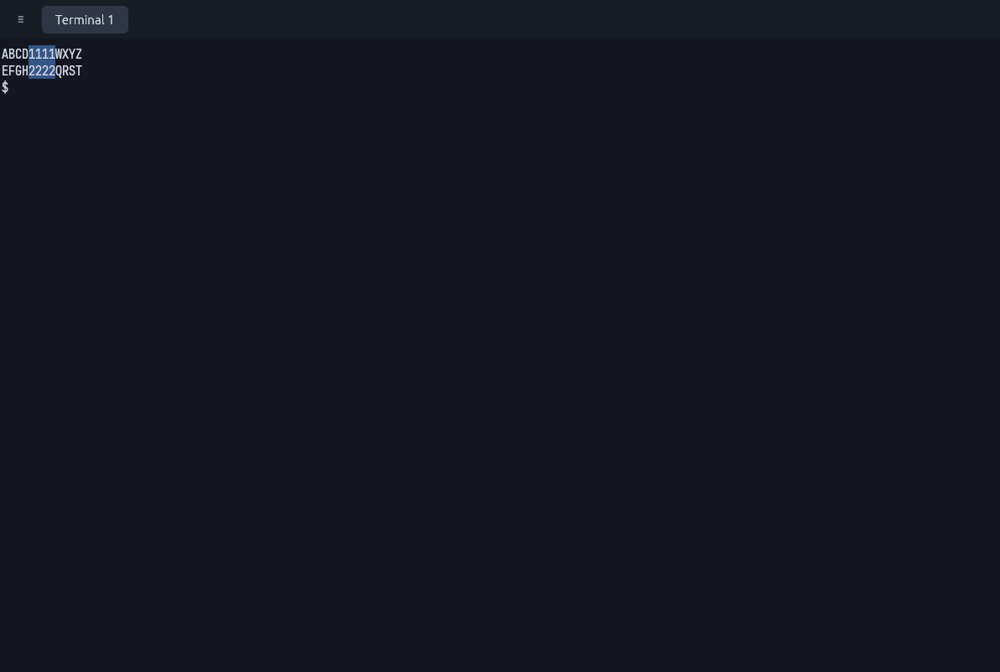
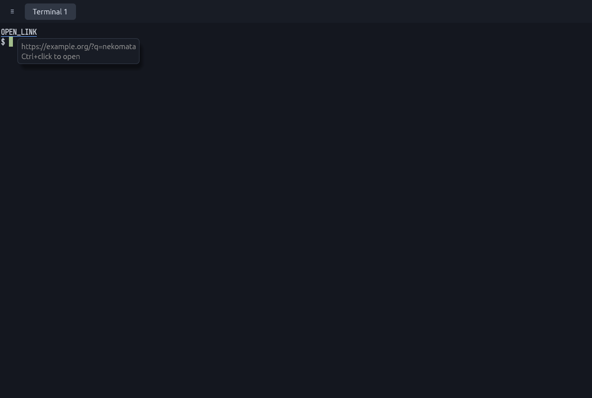
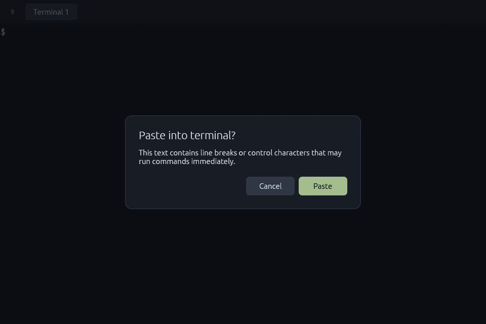
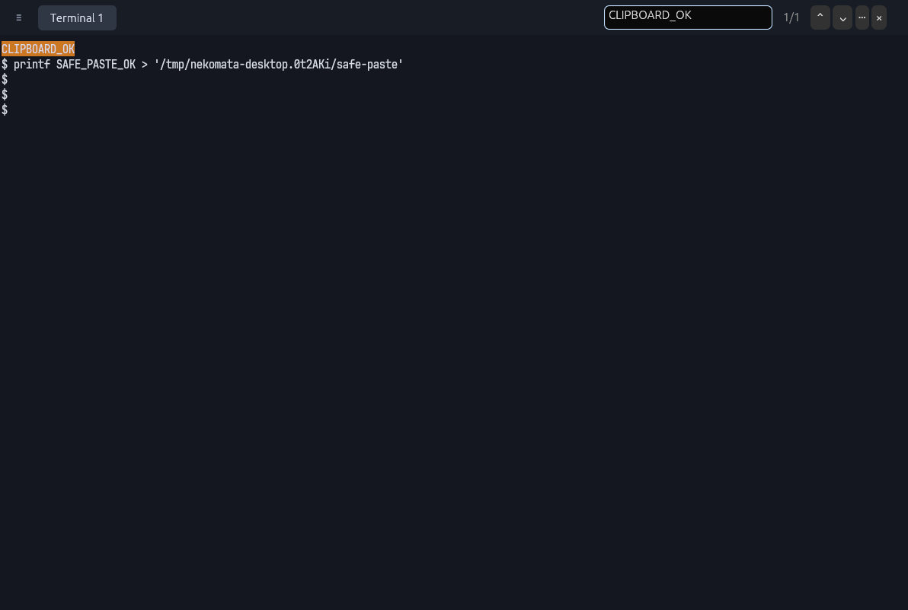
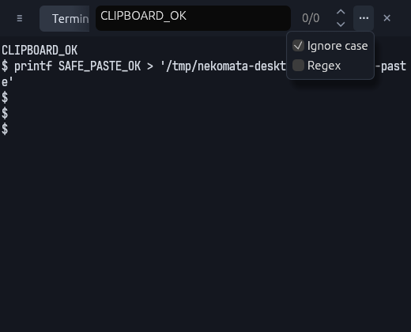
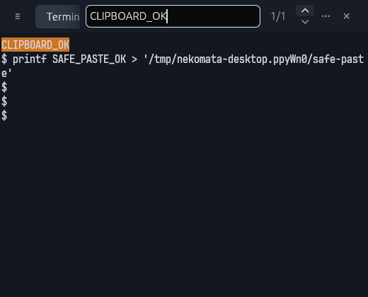

# nekomata

[felis](https://git.natsukium.com/felis-terminal/felis) のセッションに、タブと分割ペインを備えたネイティブGUIを提供します。
Rust / egui でウィンドウを描画し、felis の公開クライアントライブラリを通じて画面差分を受信します。シェル・PTY・端末の解析・スクロールバックは felis デーモンが管理します。nekomata デーモンはタブ・分割配置などの作業環境を保持し、GUI clientを再起動しても復元できるようにします。

felisの現行リポジトリは [felis-terminal/felis](https://git.natsukium.com/felis-terminal/felis) です。旧 [natsukium/felis](https://git.natsukium.com/natsukium/felis) はアーカイブされています。Cargo・Nixの依存定義とロックファイルは、いずれも移転先を参照しています。

## 端末設定

起動時に felis の `config.toml` を `felis-client-core` で読み込み、共通設定に
`[client.nekomata]` を重ねます。macOS は
`~/Library/Application Support/felis/config.toml`、Linux は
`$XDG_CONFIG_HOME/felis/config.toml`（未指定なら `~/.config/felis/config.toml`）です。
macOS では `~/.config/felis/config.toml` は読みません。

nekomata 独自の端末既定値や初期設定ファイルは提供しません。設定のない項目は felis の既定値を使います。
例えば nekomata だけ文字サイズを変える場合は、ユーザーの設定ファイルへ次を追加します。

```toml
[client.nekomata.font]
size_px = 16
```

フォント（サイズ・ファミリー・スタイル・フォールバック・OpenType features）、端末配色
（拡張パレット・minimum contrast を含む）、カーソル色・点滅設定を適用します。
`keymap` はコピー・貼り付け（system clipboard）、文字サイズ、スクロール、プロンプト移動、検索の操作と `unbind` に対応します。
アプリケーションのショートカットが先に処理され、残りを端末キーマップへ渡します。
未対応の操作へ割り当てたキーは端末プログラムへ渡します。
`window`、`shader`、`mouse`、`clipboard` の設定および設定のライブリロードは未対応です。
フォントは OS にインストールしたものを名前で選びます。
GUI 起動時は保存済みズームより設定の文字サイズを優先します。起動後に既存ワークスペースへ切り替える場合は、そのワークスペースのズーム値を復元します。新規ワークスペースとサイズのリセットにも設定値を使います。
設定変更は GUI の再起動で反映します。既定パスにファイルがなければ起動でき、構文・型の誤りや読み込み失敗は起動エラーになります。

この設定は [二層設定 ADR](docs/ADR/20261024-220000-split-configuration-into-two-layers.md) の terminal layer です。
`[client.nekomata]` に nekomata 独自の設定キーを追加することはできません。UI フォントとタブ・分割などのキーは、次のアプリケーション設定（application layer）で設定します。

## アプリケーション設定

nekomata 独自の設定は、felis の文書とは別の `config.toml` に書きます。macOS は
`~/Library/Application Support/nekomata/config.toml`、Linux は
`$XDG_CONFIG_HOME/nekomata/config.toml`（未指定なら `~/.config/nekomata/config.toml`）です。
ファイルがなければ既定値で起動します。設定できるのは次の2つです。

```toml
[appearance.base.font]
# タブ・メニュー・検索欄・コマンドパレットなど UI の文字。端末の文字は felis の [font] で設定します。
family = "UDEV Gothic NF" # 省略時は nekomata の既定 UI フォント
size_px = 15              # 省略時は kitty の既定 11 pt（macOS は 11、ほかの OS は約 14.67）

[keymap]
"alt+n"       = { kind = "new_tab" }
"alt+c"       = { kind = "unbind" }
"ctrl+a s"    = { kind = "split", direction = "down" }
"ctrl+a v"    = { kind = "split", direction = "right" }
```

`family` は OS のフォント照合（macOS は CoreText、Linux は fontconfig）でファミリー名から探します。大文字・小文字は区別しません。見つからない場合や空の場合は、警告を出して nekomata の既定 UI フォントで起動します。既定 UI フォントは、macOS ではヒラギノ角ゴシック、Linux では `/usr/share/fonts/opentype/noto/NotoSansCJK-Regular.ttc`（Debian・Ubuntu の配置）があればそれ、なければ egui の内蔵フォントです。`size_px` は整数・小数のどちらでも書けます。4〜72 の範囲外は範囲内に丸め、0 以下や無限大は既定値を使います。

`[keymap]` は felis の `[keymap]` と同じ `"キー" = { kind = "…" }` の形です。1打鍵の書き方（`alt+shift+t`、`f5`、`ctrl+shift++` など）も felis と同じです。空白で区切ると連続キーになり、`"alt+w c"` は Alt+W に続けて C を押す操作です。書いたキーは既定の割り当てを置き換えます。1打鍵だけを割り当てると、そのキーで始まる既定の連続キーは無効になります（`"alt+w"` を割り当てると `Alt+W` 系の既定はすべて外れます）。先頭のキーが単独で割り当て済みの連続キーは、最後まで押せないので警告を出して無視します。`unbind` はそのキーと、そのキーで始まる連続キーを外します。項目はキーの文字列の順（バイト順）に適用するため、`"alt+w" = { kind = "unbind" }` は、それより前に並ぶ綴りで書いた `"Alt+w v"` のような自分の割り当ても外します。その場合は警告を出します。

| `kind` | 引数 | 操作 |
| --- | --- | --- |
| `new_tab` | — | 新しいタブ |
| `close_tab` | — | タブを閉じる |
| `switch_tab` | `to = "next" \| "previous"` | 次 / 前のタブ |
| `split` | `direction = "down" \| "right"` | 下 / 右に新しいペインを開く |
| `close_pane` | — | ペインを閉じる（detach） |
| `focus_pane` | `direction = "left" \| "down" \| "up" \| "right"` または `to = "next"` | 隣 / 次のペインに移動 |
| `command_palette` | — | コマンドパレット |
| `new_workspace` | — | 新しいワークスペース |
| `open_workspaces` | — | ワークスペースの一覧 |
| `unbind` | — | 既定の割り当てを外す |

アプリケーションのキーを先に処理し、残りを felis の `[keymap]` へ渡します。連続キーの途中で Escape を押すと取り消します。そのため Escape は連続キーの先頭にだけ書けます（`"ctrl+a escape"` のような項目は警告を出して無視します）。Cmd+X / Cmd+C / Cmd+V（macOS 以外では Ctrl+X / Ctrl+C / Ctrl+V、Alt と Shift なし）はウィンドウがクリップボード操作に変換するため、キーとして届きません。これらを含む項目も警告を出して無視します。同じく、ウィンドウが区別できない打鍵（macOS 以外での `super`、egui がキーとして扱えない `é` などの文字）を含む項目も警告を出して無視します。割り当てのないキーを押すと連続キーを終え、そのキーは端末プログラムへ渡します。コピー・貼り付け・文字サイズ・スクロール・検索は端末の操作なので、felis の `[keymap]` で設定します。

未知のキーや使えない値、壊れた `[keymap]` の項目は標準エラーに警告を出して無視し、残りの設定を使います。TOML の構文や値の型の誤りは起動エラーになります。設定の変更は GUI の再起動で反映します。

## 起動

Nix と flakes を有効にした環境で実行します。

```sh
nix run .
```

ビルドしてから起動する場合:

```sh
nix build
./result/bin/nekomata
```

macOSでDock / Finderから起動する場合:

```sh
bash scripts/install-macos.sh
open ~/Applications/nekomata.app
```

インストーラーは初回に `nekomata Local Code Signing` というローカル専用証明書を作成し、以降の更新でも再利用します。秘密鍵はユーザーのデフォルトキーチェーンに非エクスポート可能な形で保存し、`codesign` に利用を許可します。証明書の信頼はユーザーのコード署名用途だけに設定し、TLSの信頼設定やシステムキーチェーンは変更しません。macOSがキーチェーン操作の認証を求めた場合は、内容を確認して許可してください。

アプリ内の実行ファイルとバンドル全体を署名・検証してからインストールします。公開証明書は `~/.local/share/nekomata/signing/certificate.pem`（`XDG_DATA_HOME` 指定時はその配下）に保存します。既存の署名証明書を使う場合は `NEKOMATA_SIGNING_IDENTITY` に名前またはフィンガープリントを指定できます。Nixストア内のアプリはアドホック署名のため、更新をまたぐローカルの署名IDはインストーラーで付与します。署名の切り替え後はGUIを再起動し、必要なデータアクセスを改めて許可してください。正当な初回のアクセス確認を省略するものではありません。

`~/Applications/nekomata.app` をDockへドラッグすると固定できます。更新時も同じインストールコマンドを使います。Nixの依存を保持するリンクは `~/.local/share/nekomata/package`（`XDG_DATA_HOME`指定時はその配下）に作成します。新しいシェルは、アプリから起動した場合はホームディレクトリ、CLIから起動した場合は元のカレントディレクトリで開きます。既存セッションへ復帰した場合は、そのシェルの状態を引き継ぎます。通常のターミナルから `nekomata` コマンドを使えるよう、インストーラーは `~/.local/bin/nekomata` へのシンボリックリンクも作成します（`~/.local/bin` をPATHに含めてください。同名の別ファイルがある場合は上書きしません）。

macOSの権限帰属を保つため、アプリのエントリーポイントにはネイティブランチャーを使います。シェルを管理するfelisデーモンは既存のものを共有するため、kittyなど別アプリから起動したデーモンを再利用すると、そのアプリ名で権限を求められることがあります。起動元を切り替えるには、既存セッションを終了してデーモンを停止した後、Dockからnekomataを起動してください。

macOSでは `$SHELL -l` でログインシェルを起動し、zshの `.zprofile` なども読み込みます。変更が反映されるのは新規セッションからです。再接続したセッションは元の環境を保持します。

felis デーモンも Nix パッケージに含まれ、初回接続時に自動起動します。felisのクライアントライブラリとデーモンのソースリビジョンは `2a3030b237947497708b962ba6be8c2adade4951` に固定しています。[上流のプロンプト再描画修正](https://git.natsukium.com/felis-terminal/felis/pulls/38)を含み、ペインをライブリサイズしても以前の幅のプロンプトが残る問題を解消します。

旧版のfelisデーモンがすでに動いている場合は、既存のシェルを終了してから `nix develop --command felis daemon stop` を実行し、nekomata を起動し直してください。GUIの再起動だけではデーモンのコードは切り替わりません。

Nixパッケージにはfish用の起動フックも含まれます。fishの初期化区間を端末に通知することで、まだコマンドを実行していない最初のプロンプトもライブリサイズ時に描き直せます。ユーザーのfish設定ファイルは変更せず、nekomataから起動するfishだけで有効になります（fish 4以降の `mark-prompt` 機能が必要です）。

flake の対象は `aarch64-darwin`、`x86_64-linux`、`aarch64-linux` です。開発時のビルド・実デーモン接続は `aarch64-darwin` で検証しています。Linux のGUIには X11 または Wayland と OpenGL が必要です。

## 操作

既定のキーは次のとおりです。タブ・分割・コマンドパレットのキーは[アプリケーション設定](#アプリケーション設定)の `[keymap]` で、端末操作のキーは felis の `[keymap]` で変更できます。

| 操作 | キー |
| --- | --- |
| 新しいタブ | Alt+C |
| 次 / 前のタブ | Alt+T / Alt+Shift+T |
| 上下に分割 | Alt+W → Alt+S |
| 左右に分割 | Alt+W → Alt+V |
| ペインを閉じる（detach） | Alt+W → C |
| 左 / 下 / 上 / 右のペインに移動 | Alt+W → H / J / K / L |
| 文字サイズを初期値に戻す | Ctrl+Shift+0 / Cmd+0（macOS） |
| 文字サイズを1.1倍 / 1÷1.1倍にする | Ctrl+Shift+= / Ctrl+Shift+-（macOSでは Cmd+= / Cmd+- も利用可能） |
| コマンドパレット | Alt+Shift+P |
| スクロールバック検索 | Ctrl+Shift+F / Cmd+F（macOS、Shiftの有無は問わない） |
| 選択をコピー | Cmd+C（macOS） / Ctrl+Shift+C（Linux） |
| 貼り付け | Ctrl+Shift+V / Cmd+V（macOS） |
| 半画面分上 / 下へスクロール | Shift+PageUp / Shift+PageDown |
| 最古の出力 / 現在の出力へ移動 | Ctrl+Shift+Home / Ctrl+Shift+End |
| 前 / 次のプロンプトへ移動 | Ctrl+Shift+Z / Ctrl+Shift+X |

`→` はキーを順番に押す操作です。分割時はシェルがOSC 7で通知した現在のローカルディレクトリを引き継ぎます。通知がない場合はnekomataの起動ディレクトリを使います。以前のタブ・分割用ショートカットは置き換えました。設定の再読み込みには対応していないため、kittyの `Alt+Shift+R` は未割り当てです。

上部は `≡ | tab1 | tab2 | …` の1行構成です。左端の `≡` メニューからワークスペースの新規作成・切り替え、タブ追加、縦横分割、ペイン・タブの閉鎖、再接続、文字サイズ変更、ヘルプを利用できます。

- ペインをクリックして選択し、分割バーをドラッグしてサイズを変更します。
- ドラッグで文字を選択します。Alt+ドラッグで矩形選択できます。TUIがマウスを利用している場合は Shift+ドラッグ、矩形選択は Shift+Alt+ドラッグを使います。

  

- OSC 8で埋め込まれたリンクにポインターを重ねると、開く先のURLを表示します。macOSでは Cmd+クリック、Linuxでは Ctrl+クリックで既定のアプリケーションに渡します。Linuxでは `xdg-open` が必要です。URL文字列だけの自動リンク化は行いません。felisの検証を通らないリンクは開かず、開けない理由を表示します。

  
- ブラケット貼り付けが無効な端末へ改行などの制御文字を貼り付ける場合は確認します。通常の文字列・タブ、ブラケット貼り付けが有効な場合は確認なしで送信します。確認待ちの間に接続先が変わると貼り付けを破棄します。

  

- ホイール・トラックパッドで履歴をスクロールします。連続したスクロール要求はfelisの共有処理で扱い、対応デーモンには相対移動として送ります。マウス入力を要求するTUIにはホイール入力を送ります。
- `≡` メニューの `Smaller text` / `Larger text` で文字サイズを変更します。
- ウィンドウ・ペイン・タブを閉じても、シェルと実行中のコマンドはデーモン内に残ります。シェル自体を終了するには `exit` などを使います。

## スクロールバック検索

`≡` → `Find in scrollback`、コマンドパレット、または検索ショートカットで、タブバー右側に検索欄を開きます。文字列を入力して Enter または「⌄」で検索し、同じ検索語・条件のまま操作すると次の結果へ進みます。「⌃」または Shift+Enter で前の結果へ戻ります。検索欄の右には、フィルター、上下のナビゲーター、件数、閉じるボタンの順で並びます。漏斗型のフィルターアイコンの詳細メニューに `Ignore case`（初期オン）と `Regex`（初期オフ）があります。条件を変更すると次の移動操作で検索し直します。

検索結果は最大1,000件、応答の合計は1MiBまでです。件数の末尾の `+` は結果が制限されたことを示します。検索エラーは「!」にカーソルを重ねると確認できます。検索中は入力を端末へ送らず、Escape または「×」で検索欄と強調表示を閉じます。







## 端末共通のキー操作

端末共通のキー操作にはfelisのキーマップを使い、タブ・分割の操作（既定は `Alt+W` 系）は nekomata の `[keymap]` が扱います。修飾キーなしの `End` はシェルやTUIへ送ります。履歴の先頭・末尾への移動は、コマンドパレットの `Scroll to oldest output` / `Scroll to live output` からも実行できます。

`Previous prompt` / `Next prompt` はコマンドパレットからも実行できます。プロンプト移動には、**シェルがOSC 133のプロンプト境界を通知すること**が必要です。

## ワークスペースの保存・切り替え

ワークスペースは、タブ、ペインの分割配置、各ペインのfelis接続先、activeなタブとペイン、フォーカス履歴、文字サイズをまとめた作業環境です。felisのセッション（1つのシェル）とは別のIDを持ちます。以前は「nekomataセッション」と呼んでいましたが、felisのセッションと区別するためワークスペースに改めました。

起動すると、どのウィンドウにもattachされていないワークスペースのうち、最後に使ったものへ自動的にattachします。候補がなければ、1タブ・1ペインのワークスペースを作ります。1ワークスペースへattachできるウィンドウは1つで、同時起動時もデーモンが割り当てを調停します。

`≡` → `New workspace` で新しいワークスペースへ、`≡` → `Switch workspace…` で既存のワークスペースへ切り替えます。コマンドパレットにも `New workspace` / `Switch workspace` があります。切り替え先の全ペインへの接続が成功してから切り替え、失敗した場合は元のワークスペースを維持します。使用中のワークスペースを別のウィンドウから奪う操作はありません。

```sh
# ワークスペースとattach先のウィンドウを一覧表示
nekomata workspaces list

# 現在のウィンドウを新しいワークスペースへ切り替える
nekomata workspaces new

# 一覧のWORKSPACE列にあるIDへ切り替える
nekomata workspaces attach WORKSPACE_ID
nekomata workspaces attach WORKSPACE_ID --window WINDOW_ID
```

旧名の `nekomata sessions …` も非推奨の別名として引き続き使えます（標準エラー出力に非推奨の旨を表示します）。

ウィンドウを閉じると、レイアウトを保存してdetachします。UI更新後にGUIを起動し直すと、互換性のある稼働中のnekomataデーモンを再利用し、直近の未attachワークスペースとシェルへ復帰します。ペインやタブを明示的に閉じた場合は、その部分をレイアウトから取り除き、シェルはfelisに残します。

nekomataデーモンは初回起動時に自動起動し、最後のウィンドウを閉じても動き続けます。レイアウトは現在メモリ内に保持しており、**nekomataデーモンの停止・異常終了やOS再起動をまたぐ復元には未対応**です。GUIの異常終了では、デーモンに届いた最後のレイアウトまで復元します。ウィンドウをすべて閉じた後、次のコマンドでnekomataデーモンを停止できます。この操作でレイアウトは失われますが、felisのシェルは終了しません。

```sh
nekomata daemon stop
```

UIだけの更新ではデーモンを止める必要はありません。プロトコルに互換性がない場合はエラーを表示し、稼働中のデーモンを自動で置き換えません。起動時の自動attachと、通信障害後の自動再接続は別で、後者は未対応です。

## felisセッションへの再接続

インストールすると、次のコマンドでセッション一覧を確認できます。

```sh
nix profile install .
nekomata felis sessions list
nekomata felis sessions list --format json
```

一覧の取得は同梱のfelis CLIへ委譲します。`≡` メニューの `Attach…` では、起動時のローカルdaemonからセッションを選んで新しいタブで開けます。ペインを閉じるとdetachし、シェルはデーモン内で動いたままになります。

インストールせずに使う場合:

```sh
nix run . -- felis sessions list
```

`FELIS_SOCKET` を指定すると、通常とは別のローカルデーモンに接続できます。

## 起動中のペインの接続先を変更する

CLIから起動中のGUIへ指示し、既存のペインを別のセッションに切り替えられます。

```sh
# ウィンドウID、ペインID、接続先、セッションIDを確認
nekomata panes list

# activeなペインを、同じdaemonの別セッションへ切り替える
nekomata panes attach --session SESSION_ID

# 指定ペインを、別のローカルdaemonのセッションへ切り替える
nekomata panes attach 2 --daemon /path/to/felis.sock --session SESSION_ID

# SSH先の既定daemonのセッションへ切り替える
nekomata panes attach --ssh dev-server --session SESSION_ID
nekomata panes attach 2 --ssh user@host --session SESSION_ID

# SSH先の指定ソケットのdaemonへ切り替える
nekomata panes attach --ssh dev-server --daemon /run/user/1000/felis.sock --session SESSION_ID

# 複数のGUIがある場合はウィンドウを指定
nekomata panes list --window WINDOW_ID
nekomata panes attach 2 --window WINDOW_ID --session SESSION_ID
```

ペインIDはワークスペース内のIDで、GUI再起動後も維持します。felisのセッションIDとは別です。省略すると、GUIが指示を受け取った時点のactiveなペインを使います。`--daemon` と `--ssh` を省略すると対象ペインの現在の接続先を引き継ぎます。`--daemon` だけを指定した場合はローカルソケットを使い、相対パスはCLIを実行したディレクトリを基準に解決します。`--ssh` と併用した場合はSSH先のソケットを使い、相対パスはリモートのrelay起動ディレクトリを基準に解決します。空白や引用符を含むパスも、リモートシェルで展開せずそのまま渡します。セッションIDはfelisが一意に解決できる短縮形も使えます。

接続先のdaemonは起動済みで、指定セッションが存在している必要があります。接続とattachが成功してからペインを切り替え、元のセッションはdetachして残します。失敗した場合は元のペインを維持し、CLIがエラーを返します。同じペインへのattachが進行中の場合、次のattach要求はエラーになります。分割して新しいシェルを作るときも元ペインの接続先を引き継ぎます。新しいタブは起動時のローカルdaemonを使います。

ウィンドウは `--window`、環境変数 `NEKOMATA_WORKSPACE_ID` が示すワークスペースの現在のattach先、`NEKOMATA_WINDOW_ID`、起動中のGUIが1つの場合の自動選択、の順に決まります。`NEKOMATA_WORKSPACE_ID` がなければ、旧版が渡した `NEKOMATA_SESSION_ID` を使います。複数候補がある場合はエラーにウィンドウ探索用のディレクトリを表示します。nekomataで新しく作ったローカルシェルには `NEKOMATA_WORKSPACE_ID`・`NEKOMATA_WINDOW_ID`・`NEKOMATA_PANE_ID` を渡します。ワークスペースIDから現在のウィンドウを解決するため、GUI再起動後も同じシェルからCLIを使えます。既存シェルの環境変数は書き換えません。どちらの変数も持たない旧版のシェルや、別のワークスペースへ手動で移したシェルでは、必要に応じて `--window` を指定してください。

SSHの指示はGUIと同じマシンで実行します。`~/.ssh/config` のホスト名や `user@host` を使えます。SSH先には互換性のある `felis-daemon` がPATH上に必要です。公開鍵・SSH agentなどによる非対話認証を使い、パスワード入力や初回ホスト鍵確認は事前に通常のsshで済ませてください。リモートで新規シェルを作る際には、ローカルのシェルパス・cwd・環境変数を転送しません。

SSH先の既定ソケットを使う場合は `--daemon` を省略します。接続先を省略した再attachや分割では、ホストとソケットの両方を引き継ぎます。detach専用CLI、自動再接続は提供しません。

## 開発・検証

```sh
nix develop
cargo run
cargo test --locked
cargo clippy --locked --all-targets -- -D warnings
cargo fmt --check
bash scripts/test-live.sh
```

`scripts/test-live.sh` はnekomataとfelisの両方を専用ソケットで隔離し、GUIの置き換え後のタブ・分割・フォーカス・シェルの復元、ワークスペース切り替えと失敗時の維持、実際の入力・カラー表示・リサイズ・切断後の再接続を検証します。別daemonへのペイン切り替えと失敗時の維持も検証します。SSHはローカルの専用relay fixtureで通信経路を検証し、外部ホストには接続しません。終了時にはテスト専用のデーモンとセッションを片付けます。

```sh
nix flake check
nix fmt -- flake.nix
```

## 初版の対応範囲

テキスト、256色 / RGB、CJK文字、選択・コピー・貼り付け、スクロールバック、名前付きキー、マウス入力、IME確定文字の送信、OSC 52によるシステムクリップボードへの書き込みに対応しています。NeovimのOSC 52プロバイダーからの `"+yy` も利用できます。Braille文字（U+2800–U+28FF）はフォントに依存せずセル内に直接描画するため、Codexのロゴなどの点字アートも表示できます。端末フォントは felis の設定から選び、未指定なら felis のシステムフォント探索を使います。`NEKOMATA_FONT` による実行時の上書きは行いません。

端末描画には `felis-render-wgpu` を使い、egui と同じ GPU device/queue 上のテクスチャを合成します。felis のシェーピング、行・グリフ・画像キャッシュ、装飾、Kitty 画像、動的パレット変更を利用し、通常描画で CPU への画像読み戻しは行いません。ローカル接続は表示中のペインだけが次の画面を要求し、非表示ペインの更新要求を停止します。SSH 接続は往復遅延を増やさない push 方式です。デーモン接続が切れた場合は同じセッションへの再接続を試み、配送が不確かな入力は再送しません。[描画性能と検証範囲](docs/rendering-performance.md)、[Vitro での検証](docs/vitro-rendering-validation.md)、[上流実装の流用監査](docs/felis-rendering-reuse-audit.md)、[macOS実機での累積改善](docs/native-rendering-validation.md)を参照してください。

設定によるリガチャの有効化、キー解放イベント、OSC 52 クリップボード読み取り、タブ・分割配置のディスク永続化には未対応です。

以前のメッシュ描画ではmacOSでワークスペース切り替え・GUI再起動後の復帰を確認済みです。現在の共有GPU描画はLinux/X11で画像・パレット・入力・選択コピー、macOS/Metalで文字・画像・パレット・OSC 52書き込みを確認しています。macOSのキー入力・選択操作、ネイティブIME、高DPI、TUIのマウス操作は追加確認が必要です。

## ライセンス

Apache-2.0。端末エンジンには [felis](https://git.natsukium.com/felis-terminal/felis)（Apache-2.0）を利用しています。上流を変更せず、固定したGit依存として参照しています。

[macOS で個人用の `[client.nekomata]` 設定を読み込んだ表示](docs/images/felis-config-macos.png)。
配色・UDEV Gothic NF・15 px はこの検証時のユーザー設定で、アプリケーションに同梱する既定値ではありません。

[タブの日本語・英字・点字スピナーの表示](docs/images/felis-config-tab-title-macos.png)も macOS で確認しています。タブのフォントは application layer が扱い、端末のフォント設定とは独立しています。
