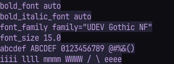
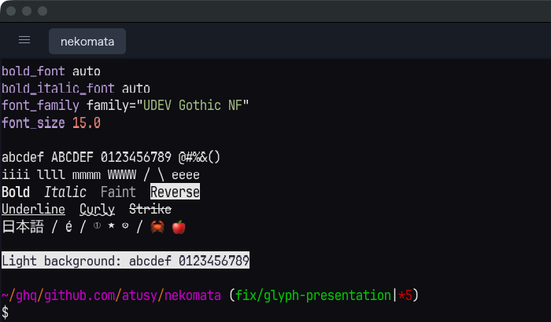

# Glyph composition on low-DPI displays

## Reproduction and diagnosis

The reported screenshot was taken on an external display without image scaling.
The connected macOS displays reported 3840×2160 physical pixels and the same
logical resolution (1x). The local nekomata font configuration selected UDEV
Gothic NF at 18 logical pixels; the `font_size 15.0` visible in the terminal is
sample file content, not nekomata's effective font size.

Rendering the same text directly into the felis Metal attachment reproduced
its heavy, uneven-looking edges before egui sampled the texture. This rules
out the final nearest-neighbour texture sampling as the cause of this
reproduction. Changing neither font outlines nor bitmap placement, blending
the same coverage in encoded sRGB removed the bright fringe.

The original glyph pass blends linear RGB into an sRGB attachment. For example,
a 25%-covered red channel between foreground 192 and background 36 becomes
approximately 106 after linear-light blending and sRGB encoding. Interpolating
the encoded values gives 75. On small light-on-dark text, that difference
makes the partially covered outline noticeably brighter and heavier.
Linear-light blending is mathematically valid; this change deliberately chooses
the sRGB text-composition convention used by egui for consistent apparent weight.

The regression test failed with the original composition path (maximum channel
error 32/255 at 15px). With the fix, sampled glyph pixels match an independent
CPU calculation from the rasterizer's coverage within 2/255 on Metal.

## Equal-size comparison

Both captures use the Nix-pinned UDEV Gothic NF Regular font at 18 physical px,
the same text/colors/grid, and the same Metal renderer. The PNGs are 360×132
pixels with no resizing. The first capture precedes the composition change;
the second uses the corrected embedded pass.

Before:


After:



## Implementation boundary

Only the embedded glyph pass uses the compatible `Rgba8Unorm` view of the
existing attachment. Glyph RGB is encoded once; coverage and opacity are
unchanged. Loading the actual attachment handles glyphs over images as well as
ordinary backgrounds. Glyphs, including color glyphs, keep their atlas/cache
and placement. The target view is cached until resize.

Backgrounds, Kitty images, decorations, and their ordering keep their existing
linear-light passes. Standalone felis surface/offscreen constructors retain the
upstream composition behavior. The vendored differences are documented in
[UPSTREAM.md](../vendor/felis-render-wgpu/UPSTREAM.md).

This adds a render-pass boundary before text and another when decorations or
images must follow it. Unchanged panes still reuse the complete texture.

## Native macOS inspection

The debug application ran on Apple M4 / Metal in a private window with private
felis and nekomata daemons. `scripts/show-glyph-fixture.sh` displayed the sample,
bold/italic/faint/reverse text, underlines/strikethrough, Japanese, combining
characters, and color emoji. The screenshot below is an unscaled 700×410 crop
of that application's own window capture on the external 1x display.



Commands were injected through the private daemon. Native keyboard/IME and
physical Retina/fractional-scale displays were not exercised. The GPU test's
36px case covers 18px text at 2x raster resolution, not native Retina acceptance.
The installed application was not replaced.

## Reproduction commands

```sh
nix develop -c cargo test --locked
nix develop -c cargo test --locked gpu_glyph_coverage -- --ignored --nocapture
nix develop -c cargo test --locked gpu_shared_device -- --ignored --nocapture
nix develop -c cargo clippy --locked --all-targets -- -D warnings
nix develop -c cargo fmt --check
nix develop -c bash scripts/test-live.sh
nix flake check
```

For raw visual fixtures, create a directory and set `NEKOMATA_GLYPH_CAPTURE` to
its absolute path when running `gpu_glyph_coverage`. It writes PPM files for
15/18/36px on dark/light backgrounds. The reference compares leading glyphs
that naturally fit their cells; other fixture glyphs can intentionally be
shaped or fitted by upstream. It also verifies resize, frame capture, and
images both underneath and above text.

## Completed macOS checks

At implementation commit `529933c`: ordinary tests (94 passed, 18 ignored),
clippy with warnings denied, formatting, the two Metal GPU tests, and the
isolated live suite passed. The live runner completed its 12 primary tests,
two SSH-carrier tests, and the pane-attachment check with the private relay.
