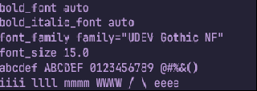
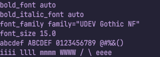
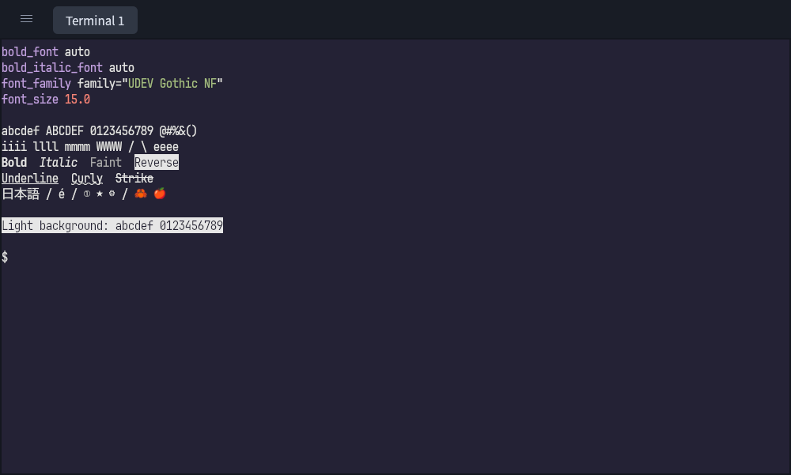

# Preserve felis pixels through egui

## Cause and correction

At 15px on a 1x external display, glyphs were intact near the top but appeared
broken further down the window. The upstream felis attachment contained the
correct pixels; the defect appeared when egui presented that attachment.

Centering an odd amount of leftover space placed the terminal texture at a
half-physical-pixel origin. Split panes can also have fractional horizontal
origins. With nearest-neighbour sampling, these coordinates lie exactly on
texel boundaries: interpolation rounding can select adjacent rows or columns
at different positions within the same glyph.

Felis's `letterbox_origin` already uses whole physical pixels for centering.
The nekomata adapter now follows that principle when positioning the completed
texture. It rounds the origin and extent in physical pixels, retaining a 1:1
mapping with the render target. An odd pixel of slack goes into a margin rather
than splitting pixel rows. Rendering, clipping, mouse/selection/IME coordinates
share that rectangle; reported terminal pixel dimensions use rounding too.

The final change preserves upstream felis rasterization, atlases, shaders,
color composition and draw passes. There is no new GPU pass or render state.
The earlier sRGB composition experiment was removed: it changed apparent weight
but did not fix the placement defect. The vendored renderer is identical to
`main` for this PR.

## GPU reproduction

Both captures below use the same upstream renderer, UDEV Gothic NF Regular at
15 physical pixels, colors and text. They show the **final egui output**, cropped
without resizing to 320×114 pixels. Only placement changes.

Before, with the old half-pixel rectangle:



After, with a physical-pixel-aligned rectangle:



On Metal, the old placement produced 22,619 channel values differing by more
than 1/255 from the source attachment. The corrected placement has zero such
differences. This catches a defect the earlier offscreen-only test missed.

The regression draws the actual felis texture through egui's native texture
registry, tessellation and GPU render pass, then reads the final framebuffer.
Dithering is disabled to isolate sampling. It checks 15/18/36px fonts on dark
and light backgrounds at compositor scales 1, 1.25, 1.5 and 2. CPU tests cover
odd leftover pixels and panes shorter than one terminal row.

## Validation

- macOS / Apple M4 / Metal: 96 ordinary Rust tests, both GPU tests, formatting,
  clippy with warnings denied, and the isolated live suite passed.
- Debian ARM64 in Vitro / Vulkan llvmpipe (Mesa 26.2.5): the final compositor
  regression passed at all four scales. Its build used
  `CARGO_PROFILE_DEV_DEBUG=0 CARGO_INCREMENTAL=0` to fit the lab's disk.
- `nix flake check` passed the aarch64-darwin package and fish checks.
- The macOS package was built and installed through `scripts/install-macos.sh`;
  strict bundle signature verification and CLI help passed. No native window
  was launched after installation.

Physical Retina/fractional-scale monitor acceptance remains unverified; the
scale matrix above is offscreen GPU validation. Native window screenshots and
resize checks use the disposable Vitro desktop.

Reproduce:

```sh
nix develop -c cargo test --locked
nix develop -c cargo test --locked gpu_compositor -- --ignored --nocapture
nix develop -c cargo test --locked gpu_shared_device -- --ignored --nocapture
nix develop -c cargo clippy --locked --all-targets -- -D warnings
nix develop -c cargo fmt --check
nix develop -c bash scripts/test-live.sh
```

Set `NEKOMATA_GLYPH_CAPTURE` to an existing directory to save raw and presented
PPM fixtures. In a private GUI session, `bash scripts/show-glyph-fixture.sh`
prints text, styles, combining characters, Japanese and emoji for inspection.

## Vitro window inspection

A private X11 window used UDEV Gothic NF at 15px, with private config/font,
nekomata and felis directories. The window was resized to 1000×600 and
1000×601; both corrected captures retained complete glyphs across all lines.
The fixture includes normal/bold/italic/faint/reverse text, underlines,
strikethrough, Japanese, combining accents and color emoji.



The software renderer did not show the same obvious broken edges as Metal in
its baseline GUI screenshots. Texel-boundary rounding is backend-dependent;
the deterministic Metal compositor regression supplies the before/after defect
reproduction. The Vitro capture verifies the corrected Linux window and resize
path, rather than claiming native macOS acceptance.
