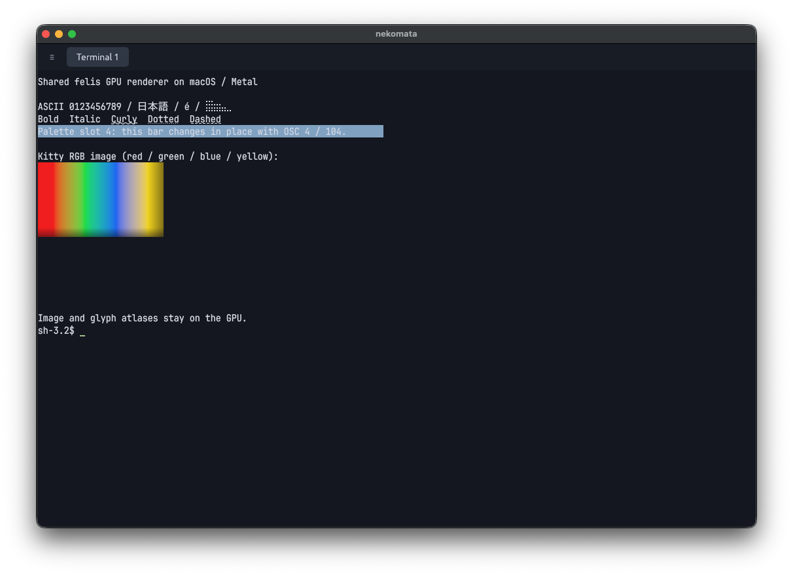

# Native macOS validation and total rendering improvements

2026-10-24, macOS 26.5.1 (25F80), Mac16,12, **Apple M4 / Metal**.
Production source: `b339e2c`; comparison harness: `6317692`.
The signed Nix application was installed in `~/Applications/nekomata.app`;
strict/deep signature verification and the managed CLI symlink passed.
The existing user window and normal daemons were left untouched.

## Native inspection

The installed bundle was launched through LaunchServices into private nekomata
and felis socket directories. Its native window displayed ASCII, Japanese,
combining accents, Braille, bold/italic, curly/dotted/dashed underlines, and a
scaled Kitty RGB image. OSC 4 changed existing cells to magenta; OSC 104 restored
the configured color. The Metal offscreen pixel test separately passed exact
image/palette RGBA assertions. OSC 52 wrote the expected marker to the macOS
pasteboard; the original pasteboard items and data types were restored afterward.



Fixture commands were injected through the private daemon, not native keyboard
events. The automation process lacked Accessibility authorization, so native
key delivery, mouse selection, resize gestures and IME composition remain
unverified on macOS. Linux/X11 native keyboard and selection-copy checks passed
in the [Vitro run](vitro-rendering-validation.md). This capture does not establish
Retina/high-DPI correctness. The cursor blink/preedit adapters have unit tests,
but this inspection does not claim native IME acceptance.

## Total CPU cost comparison

All three paths ran in the same release test process with egui 0.37, the packaged
font, identical ASCII grids, row changes and pane rectangles. Each result is the
median of 100 frames after 10 warmup frames. The initial implementation is the
frozen per-cell path from `1f7eb18`; the intermediate path uses shared render-core
meshes; the current path embeds the shared GPU renderer. These measurements do
not multiply ratios from different hosts or earlier egui versions.

| Panes | Grid/pane | Changed rows | Initial ms | Mesh ms | Current ms | Initial/current | Mesh/current |
| --- | --- | --- | ---: | ---: | ---: | ---: | ---: |
| 1 | 80×24 | none | 0.7185 | 0.1039 | 0.0025 | 292.31× | 42.28× |
| 1 | 80×24 | one | 0.7265 | 0.1135 | 0.0542 | 13.40× | 2.09× |
| 1 | 80×24 | all | 0.7287 | 0.3202 | 0.1765 | 4.13× | 1.81× |
| 1 | 200×60 | none | 5.2695 | 0.6687 | 0.0027 | 1945.89× | 246.94× |
| 1 | 200×60 | one | 5.6861 | 0.6932 | 0.0710 | 80.09× | 9.76× |
| 1 | 200×60 | all | 5.6714 | 2.0368 | 0.8821 | 6.43× | 2.31× |
| 4 | 120×40 | none | 8.6765 | 1.1228 | 0.0035 | 2479.01× | 320.80× |
| 4 | 120×40 | one/pane | 8.2525 | 1.1763 | 0.2225 | 37.10× | 5.29× |
| 4 | 120×40 | all | 8.2185 | 3.4827 | 1.5864 | 5.18× | 2.20× |

Full-grid updates cost **76–84% less CPU time than the initial renderer** and
45–57% less than the mesh adapter. One-row updates improve 13–80× against the
initial path and 2.1–9.8× against meshes in this run. The very large unchanged
ratios describe skipping terminal preparation/submission by retaining a complete
texture; they do not describe equivalent FPS or whole-application speedups.
A preceding run had full-grid speedups of 3.79–6.70×, consistent with normal
measurement variation; the table is the complete final run, not selected minima.

Timing includes egui processing/tessellation and, for the current path, terminal
GPU command submission. GPU completion is drained outside the timed region.
Final egui GPU compositing, surface presentation, input latency, PTY processing,
font discovery/startup and process memory are not measured. The CPU-only paths
also omit their final GPU draw/upload costs. There is no single meaningful
whole-application improvement percentage without a defined workload mix.

The software-Vulkan four-pane regression observed in Vitro did **not** recur on
Metal: current full-grid submission was 1.5864 ms versus 3.4827 ms for meshes.
This does not erase that software-adapter limitation.

Reproduce:

```sh
nix develop -c cargo test --release --locked benchmark_gpu_submission -- --ignored --nocapture --test-threads=1
nix develop -c cargo test --release --locked gpu_shared_device -- --ignored --nocapture
```

Ordinary tests (57), clippy with warnings rejected, formatting, the release
comparison and Metal pixel validation passed. The installed runtime came from
the previously completed Nix package/fish checks; this follow-up changes only
the benchmark and documentation.

## Improvements across the complete change

- Share the complete GPU text/background/decoration/image pipeline and its
  shaping, glyph, row and image caches; interactive frames avoid CPU readback.
- Pull complete local frames only for visible panes, retain the last complete
  texture, and bound/coalesce outgoing work while preserving ordered input.
- Reattach the same persistent session after transport failure without spawning
  another shell or replaying input whose delivery is uncertain.
- Add Kitty images and runtime theme/palette changes/reset semantics.
- Share selection normalization, soft-wrap/wide-cell extraction, word/line
  selection, cursor blink deadlines, and IME preedit rendering.
- Fix native-focus IME startup, initial drag anchoring, Linux copy shortcuts,
  and explicit clipboard support required by the egui upgrade.

For the precise remaining optional features and ownership boundaries, see the
[reuse audit](felis-rendering-reuse-audit.md). Native IME/high-DPI acceptance,
software-adapter performance, and full end-to-end presentation timing remain
separate follow-up work; no claim is made that every upstream feature is enabled.
