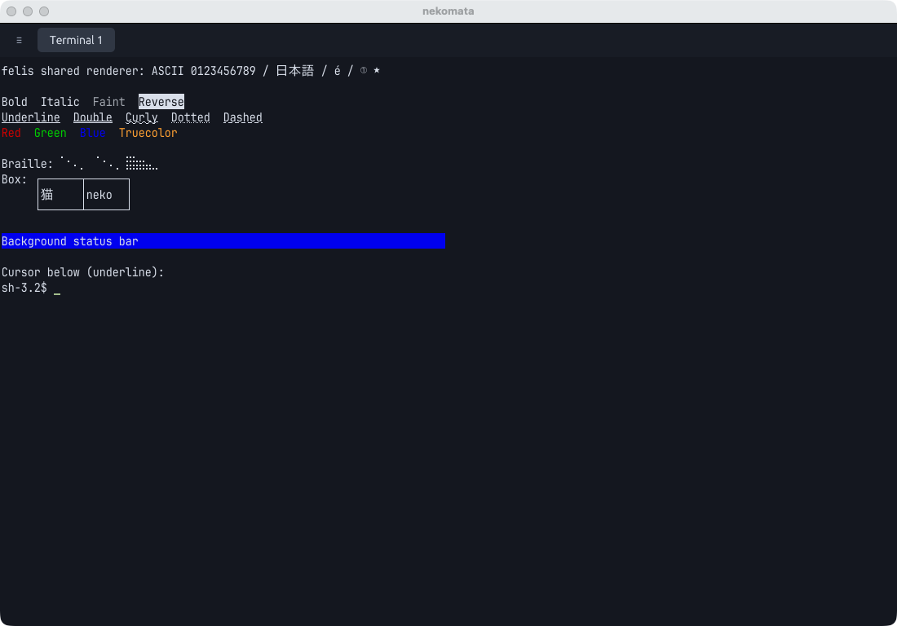

# Shared felis rendering

nekomata uses `felis-render-core` at revision
`2a3030b237947497708b962ba6be8c2adade4951` for cell appearance, shaping,
rasterization, glyph atlases and terminal decorations. The adapter in
`src/render.rs` uploads new atlas regions to egui textures and caches row meshes.
Screen damage invalidates changed rows; cursor, selection and reverse-video
state invalidate affected rows. Resizing, zooming, DPI changes and atlas
recycling invalidate the geometry that depends on them.

## CPU rendering comparison

Run the same-process comparison in the Nix development environment:

```sh
nix develop -c cargo test --release --locked benchmark_terminal_rendering -- \
  --ignored --nocapture --test-threads=1
```

The test-only baseline in `tests/support/legacy_renderer.rs` and
`tests/support/legacy_glyph.rs` preserves the per-cell painter from `1f7eb18`.
Both paths receive the same ASCII grid and row deltas, the same font file and
font size, and a viewport large enough to show every cell with either metric
system. Every sample includes egui frame processing and tessellation. Setup,
font discovery and initial atlas population are excluded after ten warmup
frames. Values below are medians of 100 frames on the development Apple Silicon
Mac, measured on 2026-10-24 at nekomata `4758ab3` with felis `631c33c`.
The final felis pin `2a3030b` adds the 0.3.1 release metadata without changing
the renderer or shaper source.

| Panes | Grid per pane | Changed rows | Previous (ms) | Shared (ms) | Speedup |
| --- | --- | --- | ---: | ---: | ---: |
| 1 | 80×24 | none | 0.5377 | 0.0672 | 8.00× |
| 1 | 80×24 | one | 0.4368 | 0.0736 | 5.93× |
| 1 | 80×24 | all | 0.4360 | 0.2181 | 2.00× |
| 1 | 200×60 | none | 2.9857 | 0.3757 | 7.95× |
| 1 | 200×60 | one | 3.0895 | 0.3885 | 7.95× |
| 1 | 200×60 | all | 3.0757 | 1.1740 | 2.62× |
| 4 | 120×40 | none | 4.3613 | 0.6334 | 6.89× |
| 4 | 120×40 | one per pane | 4.3707 | 0.6672 | 6.55× |
| 4 | 120×40 | all | 4.3785 | 1.9825 | 2.21× |

These measure CPU preparation, not GPU frame time, presentation latency or PTY
throughput. The shared path uses two tessellated primitives per pane for this
fixture, versus one for the baseline; less CPU work does not imply fewer draw
calls. The full-update case changes every row with already-warm ASCII glyphs;
it does not measure CJK/emoji atlas churn or continually arriving new glyphs.
Hardware and workload affect the results, so the benchmark reports timings
without a flaky speed threshold assertion.

## Native visual check

A development macOS window was connected to private felis and nekomata daemons.
Run `bash scripts/show-rendering-fixture.sh` inside nekomata to reproduce the
visual fixture (it clears that terminal screen).
The fixture exercised Japanese text, a combining accent, symbols, Braille,
box drawing, foreground/background colors, bold/italic/faint/reverse attributes,
underline variants and an underline cursor. The screenshot predates restoration
of the existing Nord base palette; its saturated ANSI colors are the upstream
xterm defaults.



Automated regressions separately check row reuse, row damage, cursor/focus and
selection invalidation, pane movement, right-edge backgrounds and color-glyph
opacity, wide/combining text, atlas recycling and display density. The ignored live suite tests private local and SSH relay attachments,
resizing, restart/session restoration, shell exit and clipboard forwarding.

## Final validation

With the final felis 0.3.1 pin: 50 ordinary Rust tests passed (the live tests and
release benchmark are intentionally ignored by the ordinary command), along
with rustfmt and clippy with warnings denied. `scripts/test-live.sh` passed its
private local-daemon and SSH relay cases. `nix flake check` built and tested the
macOS package and fish integration; `nix flake check --all-systems --no-build`
evaluated every declared target. Linux packages were evaluated, not built or
run. The native screenshot above used the development renderer before the
palette restoration, with the same shared rendering source as the final pin.
