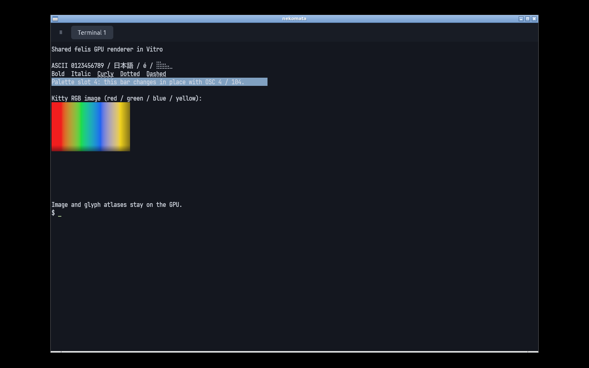
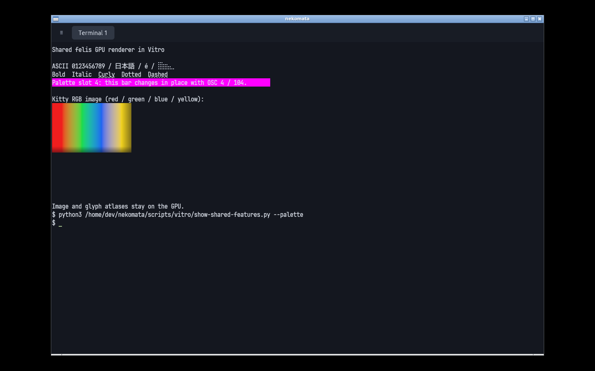

# Vitro validation of shared felis rendering

Date: 2026-10-24 (JST). Renderer/client pin: felis 0.3.1,
`2a3030b237947497708b962ba6be8c2adade4951`. Comparison harness `b1b2439`; the table predates the final presentation and
selection-hook fixes in `ea686f0` and `753adf7`. Reproduction scripts are in
[`scripts/vitro`](../scripts/vitro/README.md).

## Environment and isolation

Vitro 0.6.1 (`672373f2c7807cbd675211d302dc044a400957d7`) invoked through Nix,
QEMU 11.1.2/HVF, Debian 13 ARM64, generic kernel 6.12.113, Openbox/X11,
4 vCPUs, 8 GiB RAM, 40 GiB disk. The application and tests use Nix dependencies
and the Nix font. The selected Vulkan adapter is **llvmpipe**, Mesa 26.2.5,
LLVM 21.1.8, device type `Cpu`. This is software rendering, not a measurement
of the Mac's Metal GPU. The Debian desktop's own GL installation reports
Mesa 25.0.7; the application explicitly loads its matching Nix Mesa instead.

Dedicated Vitro XDG directories and SSH keys isolate the lab from ordinary
VMs. Separate private felis/nekomata socket directories isolate baseline,
final GUI and each live test. Closing GUI panes detaches persistent shells.
Neither test cleanup nor reconnect testing targets the user's normal daemon.

## Behavior evidence

The guest passed the ordinary Rust suite (57 passed), clippy with warnings
rejected, all 10 local live tests, the SSH carrier fixture and the explicit
remote-socket pane fixture. GPU pixel validation also passed on Vulkan.
These cover input/resize/reattach, bounded/coalesced queues, soft-wrapped copy
extraction, palette reset, OSC 52 writes, images, persistent workspaces,
shell exit, pause/resume of hidden pane pulls, and reconnection through a
controlled proxy disconnect while preserving a shell variable and session ID.

The GPU test reads back a small offscreen target and asserts exact RGBA values
for a placed image and an overridden palette background. Readback is confined
to the validation test. Normal panes sample the shared-device texture directly.

Actual guest windows displayed ASCII, Japanese, combining accents, Braille,
bold/italic, underline variants and a scaled Kitty RGB image. OSC 4 changed an
already displayed background to magenta; OSC 104 restored the configured Nord
color. Resizing from 1192×802 to 1000×700 changed the daemon's dimensions from
37×148 to 32×124 while preserving the image and text.

The [source/API reuse audit](felis-rendering-reuse-audit.md) records active
shared components and optional upstream features not exposed by nekomata.

## Same-process CPU submission comparison

Release builds, 10 warmup frames, median of 100 samples. Both paths use egui
0.37, the same font, ASCII cells, pane rectangles and row updates. The mesh
fixture is the previous render-core adapter, retained under `tests/support`.
The GPU path is the production adapter, including native texture registration,
command submission and unchanged-texture reuse. Egui processing/tessellation
is included; final egui GPU compositing is not timed; setup/font discovery is excluded. GPU completion is drained
**outside** the timed CPU sample to prevent an unbounded queue accumulating.

| Panes | Grid/pane | Changed rows | Mesh CPU ms | GPU submit CPU ms | Mesh/GPU |
| --- | --- | --- | ---: | ---: | ---: |
| 1 | 80×24 | none | 0.1752 | 0.0038 | 46.71× |
| 1 | 80×24 | one | 0.1918 | 0.2103 | 0.91× |
| 1 | 80×24 | all | 0.5828 | 0.4370 | 1.33× |
| 1 | 200×60 | none | 1.0725 | 0.0039 | 273.81× |
| 1 | 200×60 | one | 1.1188 | 0.2375 | 4.71× |
| 1 | 200×60 | all | 3.5883 | 1.8278 | 1.96× |
| 4 | 120×40 | none | 1.8213 | 0.0049 | 373.59× |
| 4 | 120×40 | one/pane | 2.0333 | 67.8013 | 0.03× |
| 4 | 120×40 | all | 6.0350 | 87.9920 | 0.07× |

These are CPU submission costs, not presented FPS or end-to-end latency.
The CPU Vulkan adapter can execute/block during submission itself, especially
across multiple pane submissions; draining afterward does not subtract that
cost. The changing four-pane cases are a **software-adapter regression** in
this run. The unchanged cases benefit mainly from retaining complete textures.
Do not interpret either as proof of native GPU performance. The test reports
measurements rather than asserting an unstable speed threshold.

For historical comparison against the original per-cell painter, see
[rendering-performance.md](rendering-performance.md). Its older egui version,
machine/load and timings are separate from the table above.

## Limits

The guest proves Linux software-Vulkan integration and protocol behavior.
Native macOS GPU latency, high-DPI presentation and IME require separate GUI
checks. The native X11 smoke test additionally passed typed shell input, double-click
word selection, Ctrl+Shift+C clipboard copy, and drag copy from the pressed cell.
The eframe clipboard feature is explicitly enabled. An X11 startup input failure was traced to enabling IME before native focus
and fixed. The isolated desktop regression verifies a typed command reaches
the shell. Native IME composition is still unverified.
